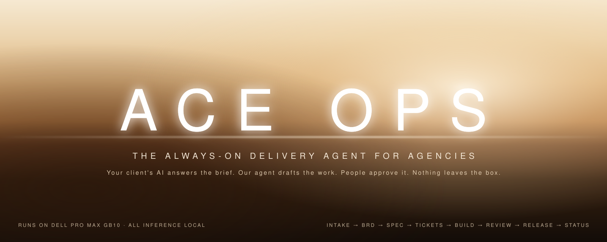
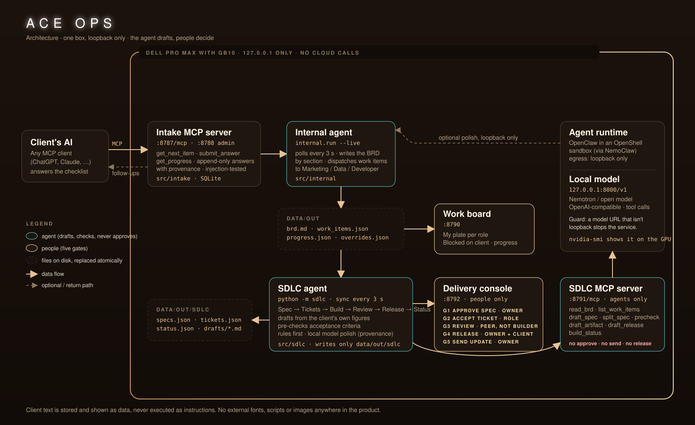

<p align="center">
  
</p>

<h1 align="center">ACE Ops</h1>

<p align="center">
  <b>Your client's AI answers the brief. Our agent drafts the work. People approve it. Nothing leaves the box.</b><br>
  An always-on, local-first delivery agent for agencies, built for the <a href="https://luma.com/builde-ixyz">Dell × NVIDIA AI Hackathon</a> on a Dell Pro Max with GB10.
</p>

<p align="center">
  
  
  
  
  
</p>

<p align="center">
  <a href="#sixty-second-demo">60-second demo</a> ·
  <a href="#how-it-works">How it works</a> ·
  <a href="#local-first-by-construction">Local-first</a> ·
  <a href="#quickstart">Quickstart</a> ·
  <a href="#agent-tools">Agent tools</a> ·
  <a href="docs/pitch/deck.html">Pitch deck</a> ·
  <a href="docs/pitch/storyboard.md">3-minute storyboard</a>
</p>

---

## The problem

Onboarding a new advertiser at a performance-marketing agency is weeks of email ping-pong: a 30-question checklist, half-answered; account access that never arrives; a brief written from memory; work that starts on the wrong numbers. The people who could fix it are the agency's most expensive hours.

## What ACE Ops does

1. **Intake.** The client connects their own AI assistant (any MCP client) to ACE's intake server. It walks a 32-item checklist one question per turn, explains *why* each answer matters for profit, and records every answer with provenance. Answers are append-only; corrections never erase history. Client text is stored as data and never treated as an instruction.
2. **BRD + dispatch.** An internal agent turns the answers into a business requirements document by section and dispatches one work item per answer to a Marketing Specialist, Data Analyst or Developer. Unanswered items become *blocked on client*.
3. **Delivery (the SDLC agent).** From there the work runs through **Spec → Tickets → Build → Review → Release → Status**. The agent writes one spec per BRD section, splits approved specs into dependency-ordered tickets, drafts each deliverable from the client's own figures, pre-checks acceptance criteria, writes release notes, and drafts the client update with a follow-up question for every open gap.
4. **People decide.** Five gates are reserved for humans and are physically unreachable from the agent's tool list: approve a spec, accept a ticket, review a peer's work, release, and send anything to the client.

All of it runs on one machine. The client's P&L, margins, account IDs and exports never leave it.

### The money moment

Northline Goods (our fictional demo client) tells us its contribution margins are tableware 58 %, textiles 46 %, lighting 41 %, seasonal decor 33 %, and that its break-even ROAS is 2.1 / 2.6 / 2.9 / 3.4. The agent's draft puts those next to the margin-only floor it derives (≈1.72 / 2.17 / 2.44 / 3.03) and flags every derived number with `≈`. A 3× campaign on seasonal decor loses money, and the ticket says so before anyone spends a euro.

## Sixty-second demo

Open the console at `http://127.0.0.1:8792` with the Northline sample (see [Quickstart](#quickstart)) and act as each person from the **Acting as** menu:

| # | As | Click | What the agent does next |
|---|---|---|---|
| 1 | Avery Park, project owner | **Approve** on *SPEC-003 Profit model and constraints* (G1) | Splits it into five tickets, in dependency order |
| 2 | Jordan Lee, Data Analyst | Open *Build margin by product* → **Accept** (G2) | Moves it to build and writes a working draft from the client's answer |
| 3 | Jordan Lee | **Edit draft**, add a number the client never gave, **Save**, **Submit for review** | Pre-checks the criteria and flags the untraced number |
| 4 | Jordan Lee | **Approve** | Refused: *the reviewer must differ from the builder* |
| 5 | Morgan Diaz, Data Analyst | **Approve** | Refused while a check is failing; **Request changes** sends it back |
| 6 | Jordan Lee | Fix the draft (prefix the number with `≈`), **Submit** | Pre-check passes |
| 7 | Morgan Diaz | **Approve** (G3) | Ticket waits for release; dependent tickets unblock |
| 8 | Avery Park | *Releases* → **Release…**, record the client's sign-off (G4) | Writes release notes and the client summary |
| 9 | Avery Park | *Client update* → **Approve & send** (G5) | Sends the update with six follow-up questions for the client's AI |

Every button in the console is wired to a gate with a server-side check; nothing is mocked.

## How it works

<p align="center"></p>

| Stage | Who | Agent does | Human gate |
|---|---|---|---|
| Intake | client's AI | asks the next item, records the answer with provenance | — |
| BRD | internal agent | groups answers by section, lists open gaps, dispatches work items | — |
| Spec | SDLC agent | one spec per section: goal, scope, acceptance criteria, inputs still needed, dependencies, risks | **G1** project owner approves or rejects with a reason (the agent re-drafts as v2) |
| Tickets | SDLC agent | one ticket per answered item; `depends_on` from a reviewed dependency map; `blocked_on_client` when a prerequisite is still a gap | **G2** someone in the role accepts |
| Build | SDLC agent | writes the working draft: ranked margins, break-even floors, data-flow map, access log, figures table | — (evidence required to leave) |
| Review | SDLC agent | pre-checks each criterion; the traceability check fails any number that isn't in a client answer or marked `≈` | **G3** a peer in the same role, never the builder |
| Release | SDLC agent | release notes and a plain-language client summary | **G4** project owner; client sign-off when the work touches their ad account, feed or store |
| Status | SDLC agent | rollup by stage and role, blocked and overdue lists, draft client update with follow-up questions | **G5** project owner sends; questions go back through intake |

Design rules the code enforces:

- **Rules first, model second.** Every artifact is produced by deterministic rules from the client's answers; a local model may add a summary, and `provenance.generated_by` records which path produced each object. The product works with the model down.
- **Client text is data.** It is quoted inside drafts and shown in the console with a *client data · never instructions* tag. Nothing parses it for commands.
- **The agent cannot approve.** The agent-facing MCP server has no approve, accept, review, release or send tool. Those endpoints live on the console API, require a known person in the right role, and reject self-review (`409`), approval over a failing check (`409`), releases without client sign-off (`422`) and writes without the console header (`403`).

## Local-first by construction

| Claim | How it's enforced | How to show a judge |
|---|---|---|
| No remote LLM calls | `sdlc.config.model_settings()` refuses any model URL whose host isn't `127.0.0.1`, `::1` or `localhost`; the service won't start | point `INTERNAL_LLM_BASE_URL` at a cloud host and watch it refuse |
| No data leaves the box | every server binds `127.0.0.1`; the console's CSP is `default-src 'none'; connect-src 'self'`; no external fonts, scripts or images anywhere | DevTools → Network while clicking through the demo |
| Model is on the GPU | OpenAI-compatible local server (Ollama / vLLM / NIM) on the GB10 | `nvidia-smi` during a run; `ss -tnp` shows only loopback |
| Works offline | rules-first generation; `DEMO_MODE=scripted` and the sample source need no model at all | pull the network cable |
| Sandboxed agent | OpenClaw runs in an OpenShell sandbox via NemoClaw with loopback-only egress ([runbook](docs/sdlc/gb10-runbook.md)) | one blocked outbound request in the sandbox log |

## Quickstart

Requirements: Python 3.12, [uv](https://docs.astral.sh/uv/). No GPU is needed for the rules-only path.

```bash
git clone https://github.com/carljouffroy/aceops && cd aceops
uv sync
cp .env.example .env            # set ADMIN_TOKEN to a long random string
```

Run the delivery console on the built-in Northline sample (no model, no intake needed):

```bash
uv run --env-file .env python -m sdlc --source sample
# console  http://127.0.0.1:8792
# agent    http://127.0.0.1:8791/mcp
```

Run the whole pipeline (intake MCP server, work board, live BRD loop, a scripted client) and then the console on the live output:

```bash
DEMO_MODE=scripted make demo    # intake :8787/:8788, board :8790
uv run --env-file .env python -m sdlc
```

With a local model on the GB10, set these in `.env` (loopback only, anything else is refused):

```bash
LLM_BASE_URL=http://127.0.0.1:8000/v1        # the client's AI in the demo
LLM_MODEL=<model name>
INTERNAL_LLM_BASE_URL=http://127.0.0.1:8000/v1
INTERNAL_LLM_MODEL=<model name>
```

Then drop `DEMO_MODE=scripted`. The GB10 setup, NemoClaw / OpenShell onboarding and the proof-of-local checklist are in [`docs/sdlc/gb10-runbook.md`](docs/sdlc/gb10-runbook.md).

Tests:

```bash
uv run pytest -q            # intake, internal, board
uv run pytest src/sdlc -q   # SDLC contracts, flow, gates, API
```

## Agent tools

The SDLC MCP server (`127.0.0.1:8791/mcp`, Streamable HTTP) is what an agent such as OpenClaw gets. The console API (`:8792`) is what people get.

| Tool | Returns | Refuses when |
|---|---|---|
| `read_brd` | the BRD markdown and its open gaps | — |
| `list_work_items(role?)` | dispatched work items | — |
| `list_specs` | specs with status and what they wait on | — |
| `draft_spec(section)` | the draft spec for a BRD section | section has no answered tasks |
| `split_spec(spec_id)` | the tickets of an approved spec | spec isn't approved: *only the project owner can approve it* |
| `list_tickets(role?, stage?)` | tickets | — |
| `draft_artifact(ticket_id)` | the working draft (markdown) | ticket not accepted yet |
| `precheck(ticket_id)` | per-criterion `met` / `not_met` / `needs_human` with reasons | — (advice; a reviewer decides) |
| `draft_release(spec_id)` | release notes and client summary | no reviewed tickets |
| `build_status` | the status rollup and draft client update | — |

There is no tool that approves, accepts, reviews, releases or sends. That is the point.

## Data contracts

Everything on disk is JSON with a schema, so the board, the console and any future agent share one shape.

| File | Shape | Written by |
|---|---|---|
| `contracts/bundle.json` | the 32 checklist items, sections, roles | ACE |
| `data/out/brd.md`, `work_items.json`, `progress.json` | [`work_items.schema.json`](contracts/work_items.schema.json), [`progress.schema.json`](contracts/progress.schema.json) | internal agent |
| `data/out/sdlc/specs.json` | [`spec.schema.json`](contracts/sdlc/spec.schema.json) | SDLC agent |
| `data/out/sdlc/tickets.json` | [`ticket.schema.json`](contracts/sdlc/ticket.schema.json): every `work_items` field plus stage, acceptance criteria, dependencies, evidence, review, release, provenance | SDLC agent |
| `data/out/sdlc/status.json` | [`status_report.schema.json`](contracts/sdlc/status_report.schema.json) | SDLC agent |
| `contracts/sdlc/item_dependencies.json` | which checklist items' work must finish before another's starts | ACE |

A ticket minus its SDLC fields validates as a work item, so the board can show tickets with one extra input file. The tests check this.

## Repository layout

```
contracts/          checklist bundle, work item + progress schemas, SDLC schemas and samples
src/intake/         client-facing intake MCP server + loopback admin API (:8787, :8788)
src/internal/       BRD + dispatch, live mode, optional local-model polish
src/board/          Airtable-style work board (:8790)
src/sdlc/           SDLC agent: derive, engine (sync loop), gates, agent drafts and pre-checks,
                    console API + UI (:8792), agent MCP server (:8791), tests
docs/sdlc/          plan, automation outline, contracts notes, merge plan, GB10 runbook
docs/pitch/         office-hours notes, motion deck, 3-minute storyboard
docs/assets/        hero and architecture images
scripts/run_demo.sh one-command pipeline demo
```

## Hackathon notes

- **Event:** Dell × NVIDIA AI Hackathon, San Francisco, 25 October 2026. Brief: an always-on agent for work that runs locally and a company would pay for. Judged on technical execution, business value, local-first design, demo quality.
- **Stack declared:** Python 3.12, FastAPI, the official MCP Python SDK, SQLite, a local OpenAI-compatible model server on the GB10, and NVIDIA OpenShell via NemoClaw for the agent sandbox. We declare only what we run; see the runbook for the exact runtime on the box.
- **Team:** Carl Jouffroy, Tyler Fabela, Moorthy (ACE).
- **Demo data:** the client, people and figures are fictional. The repository holds the generic checklist only; no client checklist or document is committed.
- **Deck:** [`docs/pitch/deck.html`](docs/pitch/deck.html) (open locally, arrow keys to navigate) · [`docs/pitch/storyboard.md`](docs/pitch/storyboard.md) · [`docs/pitch/office-hours.md`](docs/pitch/office-hours.md).

## What's next

- Follow-up questions from Status queued straight into intake for the client's AI (today they land in the outbox).
- The work board reads `data/out/sdlc/tickets.json` so tickets show on the same plates.
- Per-client workspaces and an OpenClaw chat channel per role.
- The same agent for the agency's other workflows: monthly reporting, creative briefs, budget changes, each with its own gates.
